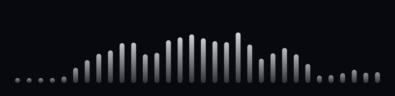
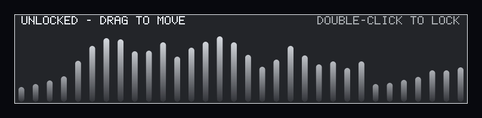
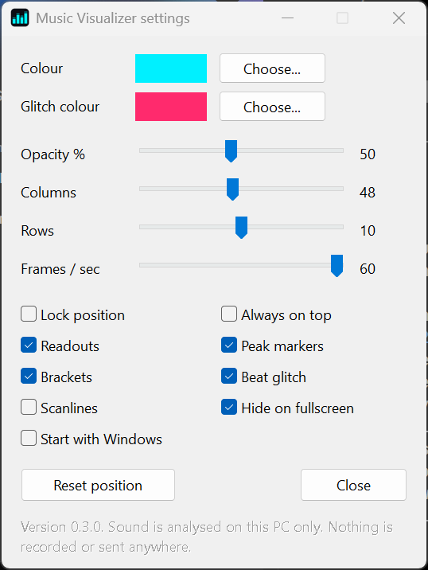

# Music Visualizer

**A 121 KB music visualizer that lives quietly on your Windows desktop.**

One `.exe`. No installer, no runtime, no browser engine. It listens to whatever your speakers are playing (Spotify, YouTube, games) and draws it as a row of soft, round-ended bars that glide with the music. Put it anywhere on your desktop, size it, lock it, and it sits behind your windows like part of the wallpaper.



[](https://github.com/rezonnnnn/Music-Visualizer/actions/workflows/build.yml)

## Get it

There is no download for now: a signed release that passes Windows security checks is in the works. Until then, [build it yourself](#build-it) (one command, about a minute), put `music-visualizer.exe` in any folder and double-click it.

1. It appears unlocked, floating on top with a frame around it. **Drag it** where you want it and **drag an edge** to resize.
2. **Double-click it** to lock. It drops behind your windows, clicks pass straight through it, and it remembers its spot.
3. To change anything later, use the **tray icon** (or just run the `.exe` again): Lock position, Settings, Start with Windows, Quit.



Windows 10 or 11, 64-bit.

## Make it yours



Everything applies as you move the controls:

- **Colour**, with the standard Windows colour picker (a soft white by default)
- **Opacity**, **columns** (8 to 96, 32 by default) and **frame rate** (15 to 60)
- **Lock position** and **Always on top** (off by default: locked, it lives on the desktop behind your windows)
- **Hide on fullscreen**: steps aside for fullscreen apps, games and presentations
- **Start with Windows**
- **Reset position**: back to bottom centre, if you lose it

Settings are saved in `%APPDATA%\MusicVisualizer\settings.ini`. It is a plain text file; edits apply within a second of saving. For a portable copy (a USB stick, say), put a `settings.ini` next to the `.exe` and it will use that one instead.

## Your sound stays on your PC

The app reads your speaker output to draw it. That is all it does with it.

- Nothing is recorded, saved or sent anywhere.
- There is no account, no telemetry and no update check.
- **The program contains no networking code at all.** Every build runs [a check](tests/check_imports.py) that fails if a networking library is ever linked or named.

## Why it's small

| | Measured |
|---|---|
| Size on disk | **123,904 bytes** (one file) |
| CPU while music plays, 60 fps | **about 0.24%** of the whole CPU |
| CPU when nothing is playing | **0.00%** |
| GPU (Intel integrated) | about 1.5% while playing, 0% when silent |
| Memory | 35 MB private, almost all of it the graphics driver Windows loads |
| Source | two C++ files, about 1,000 lines, no dependencies |

Measured in 15 to 20 second samples on a Core Ultra 5 235U laptop (14 threads, Intel integrated graphics, Windows 11, 1920x1200 at 60 Hz) with a 120 BPM test track. The silent figures were measured on version 0.3.0; the sleep behaviour is unchanged and is checked on every build.

How it stays that small:

- **One pixel shader draws everything.** Every bar, with its round ends, soft edges and fade, is computed per pixel on the GPU in a single draw call. There are no textures and no font files: the hint text shown while unlocked uses a 5x7 pixel font stored as 42 small bit patterns.
- **It only draws when the picture changes.** Bar heights are snapped to whole pixels, so a frame identical to the last one is skipped.
- **Windows does the transparency.** The widget is handed to the desktop compositor (DirectComposition), so the CPU never touches a pixel.
- **Audio comes straight from Windows.** It reads the speaker output directly (WASAPI loopback). No virtual audio cable, no "share your screen" prompt.
- **It sleeps when nothing is playing.** After 1.5 seconds of silence it fades out, stops drawing and checks for audio four times a second.
- **Nothing is allocated after start-up.** Every buffer has a fixed size.

## How it is tested

Every change is built from scratch and tested on Windows Server 2022 and 2025 before it can be released:

- **32 analysis tests**: tempo from 75 to 174 BPM at loud and very quiet volumes, at three sample rates, on a broken beat; no false tempo on noise, tones or silence; pure tones land in the right column; the level readout is accurate.
- **49 app tests** on a real desktop: first-run placement, dragging with the mouse, double-click to lock, click-through, the tray menu, the settings window, the colour picker, Start with Windows, live reload, waking for music and sleeping on silence, staying on the desktop through Win+D ("Show desktop"), recovering from a lost graphics device, returning from an off-screen position, portable mode, and a clean exit.
- **The privacy check** above.

The test machines have no sound card or GPU, so they use a built-in test signal and software graphics. Real audio and GPU numbers come from the laptop above.

## Remove it

1. Untick **Start with Windows** if you ticked it.
2. **Quit** from the tray icon and delete the `.exe`.
3. Delete the folder `%APPDATA%\MusicVisualizer` if you want your settings gone too.

Nothing else is left behind.

## Build it

You need [Zig](https://ziglang.org/download/) (about 100 MB, unzip and go; tested with 0.17.1). No Visual Studio.

```
build.cmd
```

The tests need Python with numpy: `python tests/run_tests.py build/analysis_test.exe` after building `tests/analysis_test.cpp`, and `tests/ui_test.ps1` for the app tests (it changes your Music Visualizer settings, so it is meant for a test machine). The workflow in `.github/workflows/build.yml` shows the exact commands.

## Known limits

- **Not code-signed yet**, so expect a SmartScreen prompt, and some corporate antivirus tools remove it.
- **Tested hardware is narrow**: one Intel laptop plus GitHub's test machines. AMD and Nvidia graphics, and setups with more than one monitor, have not been tried.
- **Tempo is tested on generated drum tracks**, not on a library of real songs. It shows `---` when it is not sure.
- **Switching audio devices** (plugging in headphones) is handled in the code but not covered by a test.
- **Memory** is 34 MB because of the graphics driver; a lighter drawing path is on the list.

Found a problem? [Open an issue](https://github.com/rezonnnnn/Music-Visualizer/issues).

## Licence

MIT. See [LICENSE](LICENSE). Changes are listed in [CHANGELOG.md](CHANGELOG.md).
