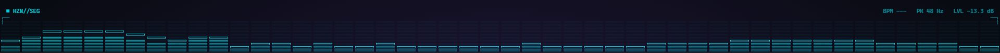
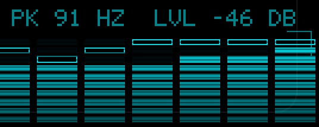

# Music Visualizer

**A 98 KB cyberpunk music visualizer that lives on your Windows desktop.**

One `.exe`. No installer, no runtime, no browser engine. It listens to whatever your speakers are playing (Spotify, YouTube, games) and draws it as a strip of neon segments above the taskbar. Clicks pass straight through it.


*Design preview (browser mockup of the Segment style).*


*Real capture of the running app, right-hand end of the strip, 2x zoom.*

## Why it's small

| | Measured |
|---|---|
| Size on disk | **98,816 bytes** (one file) |
| CPU while music plays, 60 fps | **0.15%** of the whole CPU (2.1% of one core) |
| GPU (Intel integrated) | about 4% |
| Memory | 32 MB private, almost all of it the graphics driver Windows loads |
| Source | one C++ file, about 600 lines, no dependencies |

Measured for 30 seconds on a Core Ultra 5 235U laptop (14 threads, Intel integrated graphics, Windows 11, 1920x1200 at 60 Hz) with a 120 BPM test track.

How it stays that small:

- **One pixel shader draws everything.** Bars, peak markers, scanlines, brackets and the text readouts are computed per pixel on the GPU in a single draw call. There are no textures and no font files: the readouts use a 5x7 pixel font stored as 30 small bit patterns.
- **Windows does the transparency.** The strip is handed to the desktop compositor (DirectComposition), so the CPU never touches a pixel.
- **Audio comes straight from Windows.** It reads the speaker output directly (WASAPI loopback). No virtual audio cable, no "share your screen" prompt.
- **It sleeps when nothing is playing.** After 1.5 seconds of silence it fades out, stops drawing and checks for audio four times a second.
- **Nothing is allocated after start-up.** Every buffer has a fixed size.

## What you see

- **48 columns** from 30 Hz to 16 kHz, spaced the way we hear pitch, 10 cells high.
- **Hollow peak markers** that hang above each column and fall slowly.
- **Live readouts**: tempo (BPM), loudest frequency, and level in dB.
- **Beat glitch**: on each kick a few columns jitter sideways and one scanline flashes in a second colour.
- **Scanlines and corner brackets**, because cyberpunk.

## Make it yours

A `settings.ini` appears next to the `.exe` on first run. Save the file and changes apply within a second. The tray icon has quick colour presets, **Edit settings** and **Quit**.

| Setting | Default | What it does |
|---|---|---|
| `color` | `00F0FF` | Neon colour, hex RRGGBB |
| `glitch_color` | `FF2A6D` | Colour of the beat glitch line |
| `columns` | `48` | 8 to 96 |
| `rows` | `10` | 4 to 16 |
| `height` | `6` | Bar height, percent of screen height (2 to 30) |
| `opacity` | `100` | 10 to 100 |
| `position` | `bottom` | `bottom` or `top` |
| `fps` | `60` | 15 to 60 |
| `scanlines` | `1` | Scanline effect on or off |
| `readouts` | `1` | BPM, peak frequency and level text |
| `brackets` | `1` | Corner brackets |
| `peaks` | `1` | Hollow peak-hold markers |
| `glitch` | `1` | Jitter on each beat |
| `hide_on_fullscreen` | `1` | Hide while a fullscreen app or video is in front |

## Get it

**[Download music-visualizer.exe](https://github.com/rezonnnnn/Music-Visualizer/releases/latest/download/music-visualizer.exe)** (98 KB), put it in any folder and double-click it. Play some music and look at the bottom of your screen. Quit from the tray icon.

The file is not code-signed, so Windows SmartScreen may ask you to confirm ("More info", then "Run anyway"), and some antivirus tools may block it. If you'd rather not trust a download, build it yourself below.

Windows 10 or 11, 64-bit.

## Build it

You need [Zig](https://ziglang.org/download/) (about 100 MB, unzip and go; tested with 0.17.1). No Visual Studio.

```
build.cmd
```

or directly:

```
zig c++ -target x86_64-windows-gnu -O2 -fno-exceptions -fno-rtti -s -Wl,--subsystem,windows src/main.cpp -o music-visualizer.exe -ld3d11 -ldxgi -ldcomp -lole32 -luser32 -lgdi32 -lshell32
```

## Status

This is an early version. So you know what you're getting:

- **Tested**: the default look running over a real desktop, tempo detection on a 120 BPM track, and the numbers in the table above.
- **Written but not yet tested**: custom settings and live reload, the tray menu, hiding for fullscreen apps, switching audio devices, and the sleep-on-silence path (so there is no idle CPU figure yet).
- **Antivirus**: small unsigned programs that record audio and draw over the desktop can trip corporate antivirus. One did during development. Building from source lets you see exactly what runs.
- **Next**: bring memory down (the 32 MB is the price of loading the graphics driver), skip frames when the picture hasn't changed, and sign the download.

## Licence

MIT. See [LICENSE](LICENSE).
